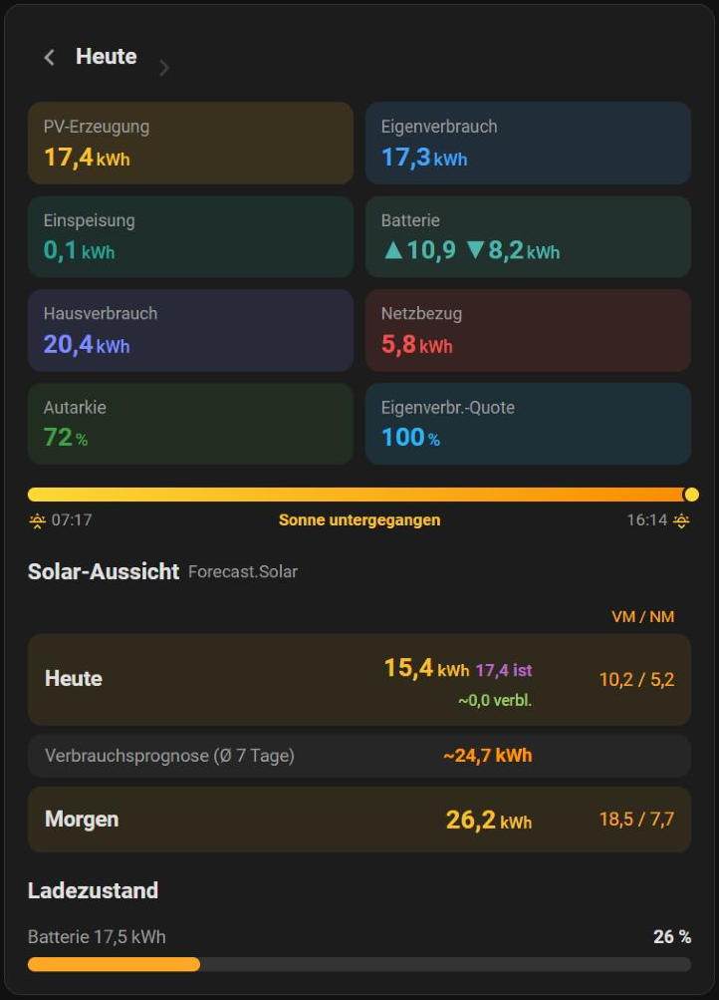

# Energie heute

PV, Verbrauch, Batterie, Autarkie heute, Tageslicht und Solar-Prognose



Die Sensoren (PV, Netzbezug, Einspeisung, Batterie …) sind nicht vorbelegt und werden in der Kartenkonfiguration oder im Karten-Editor angegeben.

## Installation

### Über den Marketplace (Home Assistant 2026.11 und neuer)

1. **Einstellungen** → **Marketplace** → **Aus Link hinzufügen**.
2. Die Adresse dieses Repositorys eintragen, Kategorie **Dashboard**.
3. **Energie heute** installieren. Die Ressource wird dabei automatisch eingetragen.

### Über HACS (ältere Versionen)

**HACS** → ⋮ → **Benutzerdefinierte Repositories** → Adresse dieses Repositorys, Typ **Dashboard** → installieren.

### Manuell

`energie-heute-karte.js` nach `/config/www/` kopieren und unter **Einstellungen** → **Dashboards** → ⋮ → **Ressourcen**
als JavaScript-Modul `/local/energie-heute-karte.js` eintragen.

## Verwendung

```yaml
type: custom:energie-heute-karte
```

## Konfiguration

```
Energie-heute-Karte: Tageskacheln, Tageslicht, Solar-Aussicht (Forecast.Solar), Ladezustand
  type: custom:energie-heute-karte
  (alle Sensoren optional ueberschreibbar: pv, bezug, einspeisung, laden, entladen, soc,
   prognose_heute, prognose_rest, prognose_morgen, batterie_name)
```

## Lizenz

MIT
